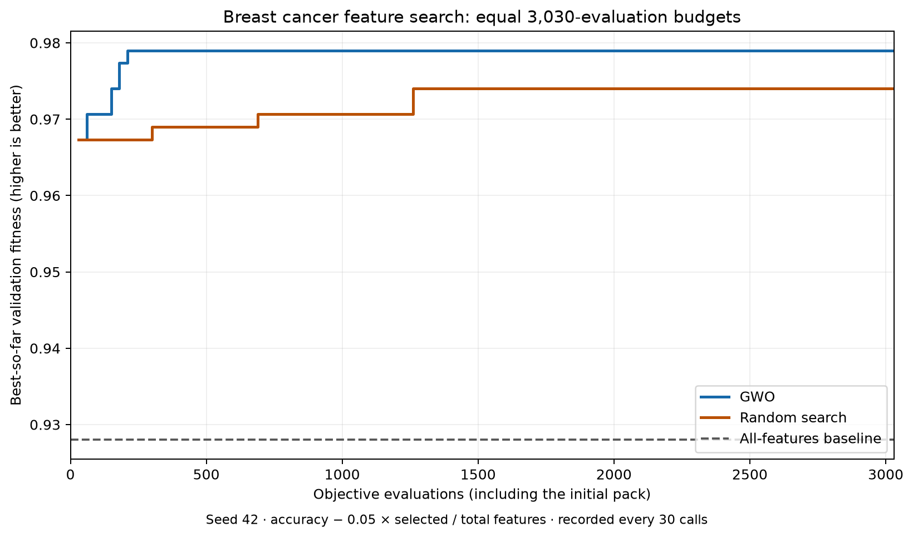

# Swarm_Dimensional_Reduction
Using a GWO to reduce the number of features in an ML model

### Big Question
What is the minimum number of features an ML model can have while still having a relatively high accuracy score?

### Algorithm

Each wolf represents a subset of the dataset's feature columns as an on/off mask.
The pack searches for subsets with high validation accuracy and fewer features.

### Measured example: breast cancer dataset

An actual run on scikit-learn's Breast Cancer Wisconsin (Diagnostic) dataset
selected **6 of 30 features (80% fewer)** from 569 samples:

| Model | Search evaluations | Features | Validation accuracy | Validation fitness ↑ | Untouched test accuracy |
| --- | ---: | ---: | ---: | ---: | ---: |
| Logistic regression with all features | — | 30 | 97.80% (89/91) | 0.928022 | 98.25% (112/114) |
| GWO-selected features | 3,030 | 6 | 98.90% (90/91) | 0.979011 | 94.74% (108/114) |
| Random-search-selected features | 3,030 | 9 | 98.90% (90/91) | 0.974011 | 95.61% (109/114) |



Both searches receive **exactly 3,030 objective calls**: GWO's 30 initial wolves
plus 100 rounds of 30 updates, versus 3,030 independently sampled random masks.
Random search enables each feature independently with probability 0.5, matching
GWO's initialization. All calls count, including duplicate and empty masks;
neither method caches scores. The same splits, seed, scaling, classifier, and
feature penalty are used. The all-features baseline and final test fits are
outside the search budget. The plot records best-so-far fitness every 30 calls,
including the initial pack, so the horizontal axis represents equal work.

GWO found three fewer features and higher penalized validation fitness than
random search at the same budget. Random search had slightly higher test
accuracy. This run demonstrates a size/fitness advantage for GWO, not a test
accuracy advantage or statistical superiority across datasets and seeds.

This demonstrates feature reduction with high accuracy in this run. The selected
subset improved validation accuracy but lost 3.51 percentage points on the test
set: fewer features did not improve generalization here. This is one fixed-seed
experiment, not evidence that the optimizer always finds the smallest subset or
outperforms the all-features model.

The selected columns were `mean texture`, `mean perimeter`, `mean compactness`,
`radius error`, `worst concave points`, and `worst symmetry`.

Reproduce from the project folder after installing requirements:

```sh
python benchmark_breast_cancer.py
```

To regenerate the plot from the saved measurements:

```sh
python -m pip install -r requirements-benchmark.txt
python plot_benchmark.py
```

The benchmark exports the built-in dataset to a temporary CSV and reads it using
the same loader as custom datasets. It reserves 114 rows (20%) for testing before
searching, then splits the remaining 455 rows into 364 training and 91 validation
rows. Both splits are stratified with seed 42. GWO uses 30 wolves, 100 iterations,
and a feature penalty of 0.05. Scaling is fitted on training data only during
search. After feature selection, each model is refitted on all 455 development
rows and scored on the untouched test set, which never influences selection.

The measured run used Python 3.14.4, NumPy 2.5.3, and scikit-learn 1.9.1; results
may differ with other versions. The script writes full scores, selected column
names, the binary mask, settings, and library versions to
[`benchmarks/breast_cancer.json`](benchmarks/breast_cancer.json).
See [the artifact guide](benchmarks/README.md) for field definitions and budget
accounting. These labeled artifacts replace the old committed result files
containing unexplained numbers; normal runs still generate their own logs.
The breast cancer dataset is only used by this optional benchmark; normal runs
use your own CSV as described below.

### Logistic regression feature selection

Install dependencies with `python -m pip install -r requirements.txt`.
Download or clone this repository and put your CSV in the project folder (or
pass its full path). Run from the project folder, replacing the filename and
target column with your own:

```sh
python main.py my_dataset.csv --target outcome --wolves 5 --iterations 20 --seed 42
```

The CSV must have a header row, numeric feature columns, and one classification
target column. The target can contain text labels or numeric class labels and
can appear anywhere in the file. For example, the file could start with:

```csv
length,width,outcome
5.1,3.5,class_a
6.2,2.8,class_b
```

Use your full dataset, with at least two classes and enough rows per class for
both training and validation. The default validation fraction is 20%; adjust it
with `--validation-size 0.3`. Each split must have room for every class.
All columns except the target become candidate features, so remove IDs and
other columns you do not want considered before running. Blank lines are skipped.
Missing values, nonnumeric features, and infinite values are rejected with an
error; clean or encode those columns first. This workflow supports tabular
classification, not continuous regression targets, images, or free text.
For semicolon-separated files, add `--delimiter ";"`. Quote paths and column
names containing spaces.

The terminal prints the all-features baseline, final score, selected column
names, and feature order. Binary masks and zero-based indices in the log files
follow that feature order, excluding the target column. The summary log also
includes the dataset path, target, feature order, and selected column names.

You can also load a CSV or supply arrays directly in Python:

```python
from main import select_features
from dataset import load_csv

X, y, feature_names = load_csv("my_dataset.csv", target="outcome")
result = select_features(X, y, num_wolves=5, max_iterations=20)
selected_columns = [i for i, bit in enumerate(result.best_position) if bit]
X_selected = X[:, selected_columns]
selected_names = [feature_names[i] for i in selected_columns]
```

Each wolf is scored initially and after every update using logistic regression
on its selected columns. Scaling is fitted only on training data. All wolves
use the same stratified training/validation split for comparable scores.
Fitness is maximized:
`validation_accuracy - 0.05 * (selected_features / total_features)`.
The denominator is the number of feature columns in your dataset. Accuracy is a
fraction between 0 and 1. Use `--feature-weight` to vary the nonnegative penalty
coefficient (zero disables the penalty). Empty masks receive fitness
`-1 - feature_weight` and are not fitted. The returned `best_accuracy` is validation
accuracy, not an independent test score. Keep final test data separate from
the data passed to `select_features`; repeated search can overfit validation data.
This is a heuristic tradeoff, not a guarantee of the smallest possible subset
or a minimum accuracy threshold. `results.txt` records the best wolf in each round
and the best found so far, with parameters, feature count, fitness, and validation
accuracy. It ends with the full final summary, including execution time.
`detailed_result.txt` records the initial pack and every wolf's details each round:
current and previous parameters, enabled/disabled feature indices (zero-based),
fitness changes, feature-count changes, and accuracy changes in percentage points.
A positive fitness change means improvement; unavailable accuracy is marked N/A.
Use `--output` and `--detailed-output` to customize the paths. By default the
detailed file is saved beside the regular file. For Python calls, `output_path=None`
disables both files unless `detailed_output_path` is explicitly supplied.
Harry Potter names come from `name.py` and stay with
each wolf throughout the run. Larger packs reuse names with numbered suffixes.
The final summary identifies the best wolf, also available as `result.best_name`.

### Module responsibilities

- `main.py` loads the dataset, evaluates an all-features baseline, runs the
  experiment, and reports results. The baseline uses the same validation split.
- `dataset.py` reads a CSV, validates its values, and separates features from
  the named target column.
- `fitness.py` evaluates feature masks with logistic regression and applies the
  feature-count penalty.
- `gwo.py` initializes the pack, updates wolf positions and leaders, and records
  per-round results and detailed wolf changes.

Run experiments with `main.py`. For custom datasets, import `select_features`
from `main`. The optimizer accepts any finite objective where higher is better.

### Tests

```sh
python -m unittest -v
```

The tests cover CSV input validation, random-search budget accounting, and GWO's
seed reproducibility, binary masks, best-so-far history, preservation of the best
candidate and its metadata, zero-iteration initialization, and protection against
objectives mutating stored positions. Optimizer tests use small synthetic
objectives and do not rerun the breast cancer benchmark.
